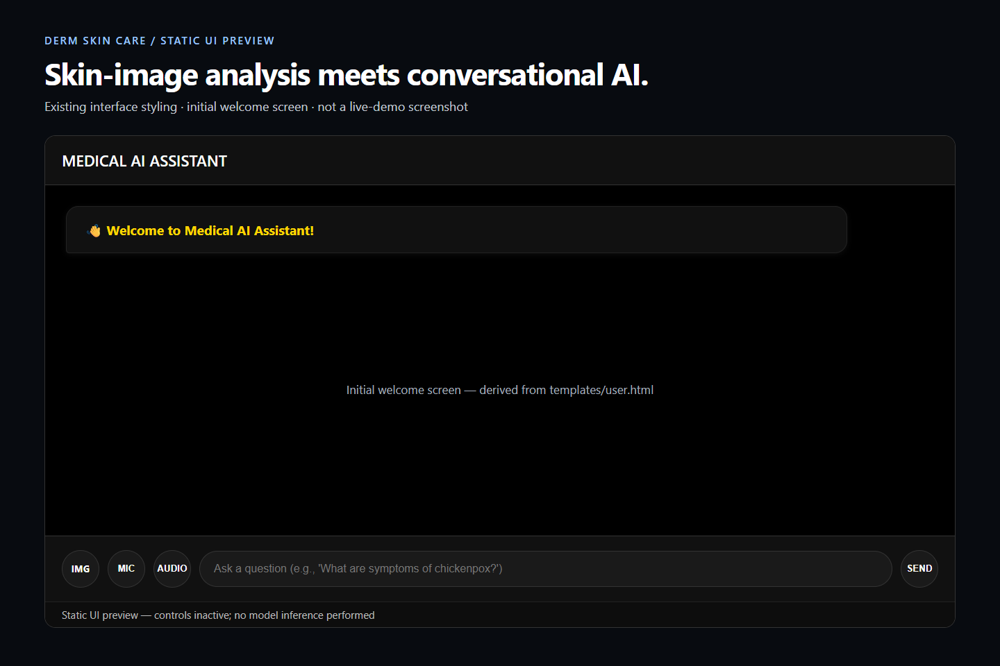
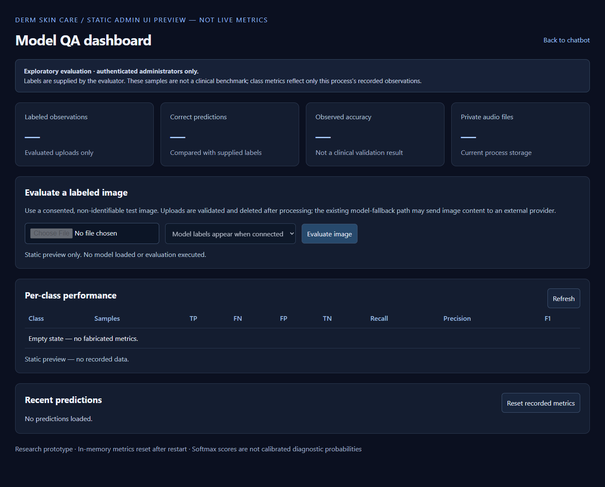

<div align="center">

# Derm Skin Care
### Skin-image classification + retrieval-augmented conversational AI

A research prototype integrating a **PyTorch vision model**, **document retrieval**, and a **conversational browser interface**.

**Python · PyTorch · ResNet18 · Flask · LangChain · Pinecone · Groq**

[Overview](#overview) · [Architecture](#architecture) · [Run locally](#run-locally) · [Evaluation](#evaluation-and-limitations)

</div>



> **Static preview, not a live-demo screenshot.** Derived from `templates/user.html`, showing the initial welcome screen. Scripts are disabled and icons are replaced with text labels. No patient images or AI-generated predictions are displayed.

## Overview

Derm Skin Care explores two complementary workflows: skin-image classification and retrieval-augmented responses to medical questions. The repository includes data preparation, transfer learning, checkpoint-based inference, PDF indexing, a Flask application and evaluation tools.

This is an end-to-end **research prototype**, not a clinically validated diagnostic service.

## Engineering highlights

| Component | Implementation |
|:--|:--|
| Vision pipeline | ImageNet-pretrained ResNet18 with a task-specific head, PyTorch training and checkpoint-based inference |
| Document retrieval | PDF loading, recursive text chunks, MiniLM embeddings and Pinecone similarity search |
| LLM integration | LangChain retrieval chains and Groq-hosted language/vision models |
| Application | Flask backend joining image inference, conversational state and optional speech output |
| User interface | Text questions, image-upload controls, browser speech-recognition controls and response-audio playback |
| Evaluation tooling | Classification report, confusion matrix, class-distribution plots and Streamlit prediction inspection |

The project demonstrates transferable skills in Python, PyTorch, data preparation, applied NLP, model integration and evaluation instrumentation. It does not claim advertising attribution, causal experimentation, production-scale deployment or clinical validation.

## Admin / model QA dashboard



> **Static empty-state preview.** Derived from the admin template; no live inference, patient images or fabricated accuracy numbers.

The protected dashboard supports labeled JPEG/PNG evaluation uploads, observed accuracy, per-class precision/recall/F1, prediction history, manual refresh and a confirmed metric reset. Only authenticated administrators can supply labels; public chat requests cannot supply evaluation ground truth. Labels are evaluator-provided, not independently verified.

## Architecture

```text
                         Browser interface
                      Text / image / voice input
                                 |
                           Flask backend
                        /                 \
                Image pipeline       Question-answering pipeline
                      |                       |
             Resize + normalize       PDF knowledge base
                      |                       |
                 ResNet18              MiniLM embeddings
                      |                       |
             Ranked predictions       Pinecone retrieval
                        \                 /
                        LLM-assisted response
                                 |
                      Text + optional speech
```

**Image path:** a saved ResNet18 checkpoint returns ranked class predictions after preprocessing. The app includes a vision-LLM fallback if the checkpoint cannot be loaded.

**Retrieval path:** PDF chunks are embedded with `sentence-transformers/all-MiniLM-L6-v2` and retrieved from Pinecone. LangChain combines retrieved text with a language model. General-model fallback behavior also exists and requires safety evaluation.

## Repository map

```text
skin_disease_chatbot/
├── app.py                    # Flask chat, image inference and audio
├── train_model.py            # ResNet18 transfer learning
├── test_model.py             # Classification report / confusion matrix
├── prepare_data.py           # Dataset preparation and merging
├── analyze_data.py           # Class-distribution plots
├── eval_dashboard.py         # Interactive prediction inspection
├── store_index.py            # PDF embedding and Pinecone indexing
├── src/helper.py             # Loading, chunking and embeddings
├── src/prompt.py             # Retrieval prompt
├── research/trials.ipynb     # Earlier RAG experiments
├── templates/user.html      # Chatbot interface
├── static/                  # Styles and interface assets
└── docs/assets/chatbot-ui-preview.png
```

## Run locally

### 1. Create an environment

The original setup uses Python 3.10. Check dependency compatibility in a fresh environment.

```bash
git clone https://github.com/husnaakhan07/skin_disease_chatbot.git
cd skin_disease_chatbot
python -m venv .venv
```

Activate on Windows:

```powershell
.\.venv\Scripts\Activate.ps1
```

Or on macOS / Linux:

```bash
source .venv/bin/activate
```

Install dependencies:

```bash
pip install -r requirements.txt
```

The current app imports `langchain_classic` and `groq`; install `langchain-classic` and `groq` in the same environment if they are not present after dependency resolution. The earlier notebook uses a different OpenAI/LangChain setup and may need separate dependency migration.

### 2. Configure credentials

Create a local `.env` file (never commit real keys):

```dotenv
PINECONE_API_KEY=your_pinecone_api_key
GROQ_API_KEY=your_groq_api_key
FLASK_SECRET_KEY=your_random_secret_of_at_least_32_characters
# Local HTTP only. Keep true for HTTPS deployments.
SESSION_COOKIE_SECURE=false
# Leave admin credentials blank to disable admin routes.
ADMIN_USERNAME=
ADMIN_PASSWORD=
TRUSTED_HOSTS=localhost,127.0.0.1,[::1]
```

The embedded Kaggle credential has been removed from the current code. **Any previously exposed token must still be revoked/rotated in Kaggle**; deleting the line does not invalidate it or clean Git history. Supply a new `KAGGLE_API_TOKEN` through your environment if needed. Review dataset licensing before downloading.

Generate `FLASK_SECRET_KEY` locally with `python -c "import secrets; print(secrets.token_hex(32))"`. Never share or commit the result. The app now fails startup if this key is missing or too short. To enable `/admin`, set a non-empty `ADMIN_USERNAME` and a strong `ADMIN_PASSWORD`; the browser will request HTTP Basic authentication. Outside localhost, require HTTPS.

### 3. Prepare the index and checkpoint

- Supply appropriately licensed PDFs in the indexing script’s configured data directory.
- Run `python store_index.py` to populate Pinecone; this contacts external services and may incur costs.
- Obtain a compatible `skin_disease_model.pth` checkpoint or train one with `python train_model.py` after auditing dataset splits. A Git LFS pointer is not the model file; retrieve the actual checkpoint if needed.

### 4. Start the local interface

```bash
flask --app app run --host 127.0.0.1 --port 8080 --no-debug
```

Open **http://127.0.0.1:8080**. This command avoids the debug-server settings in the current `python app.py` entry point. Provider access, Pinecone setup and model availability are prerequisites. These instructions are not a verified deployment recipe.

## Evaluation and limitations

No accuracy figure is reported here without a reproducible evaluation artifact. Existing evaluation scripts:

```bash
python analyze_data.py
python test_model.py
streamlit run eval_dashboard.py
```

| Area | Current limitation / next validation step |
|:--|:--|
| Data integrity | Audit merged datasets for duplicates, patient/source overlap, label alignment and train/test leakage. |
| Model selection | Introduce a dedicated validation split, fixed seeds and checkpoint selection; preserve a held-out test set. |
| Generalization | Measure per-class recall, macro-F1, external-data performance and skin-tone subgroup performance. |
| Confidence | Softmax scores are not calibrated probabilities of a correct medical diagnosis. |
| Grounding | Test retrieved-source support, hallucination, refusal behavior and unsafe medication/dosing answers. |
| Dashboard | Interactive sample history is exploratory, not a full-test-set or clinical benchmark. |
| Security | Session isolation, admin authentication, validated/private media, Markdown sanitization, trusted hosts and basic request throttling are implemented. Full application/provider testing and deployment hardening remain outstanding. |

> **Research prototype—not for medical practice.** This chatbot has not been clinically validated and must not be used for diagnosis, prescribing or treatment decisions. Reliable medical use would require substantially more representative, expertly labeled data, rigorous external testing across conditions and skin tones, and clinical oversight. A larger dataset alone does not guarantee safety or accuracy. Screenshots show example application behavior, not verified diagnoses or treatment recommendations.
>
> **Data privacy:** Do not upload sensitive or identifiable patient data to an unreviewed deployment. Images or text may be sent to external AI providers depending on the processing path.

## Security checks and deployment limits

```bash
python test_security.py
```

The regression suite exercises security helpers and selected actual route functions with ML/provider initialization excluded. It is not a full end-to-end or penetration test.

- Uploads: JPEG/PNG verification, an 8 MiB request limit, a 20-million-pixel cap, random filenames, metadata-stripping re-encoding and deletion after processing.
- Private generated audio: session-owned access; old public media paths are blocked by Flask. Delete old public files as appropriate and make sure a reverse proxy cannot bypass Flask.
- Browser protections: signed sessions, HttpOnly/SameSite cookies, cross-origin state-changing request rejection, HTML sanitization, trusted-host checks and debug disabled.
- Admin authentication: disabled without credentials; HTTP Basic auth requires HTTPS outside localhost.
- State/limits: history, audio ownership, metrics and request throttling remain in-process. Use shared storage, bounded retention, shared rate limiting, HTTPS and a production WSGI server before public deployment. Do not infer production readiness from passing these tests.
- Hostnames: update `TRUSTED_HOSTS` to your actual deployment hostname; never use a wildcard. Direct API clients must send a trusted Origin header for state-changing requests.

## Selected research context

- [Planet-wide performance of a skin disease AI algorithm validated in Korea (2025)](https://www.nature.com/articles/s41746-025-01980-w) — validation population and real-world performance.
- [Equity and Generalizability of Artificial Intelligence for Skin-Lesion Diagnosis (2025)](https://pmc.ncbi.nlm.nih.gov/articles/PMC12735087/) — generalization across image settings and skin tones.
- [Development and evaluation of a lightweight large language model chatbot for medication enquiry (2025)](https://pmc.ncbi.nlm.nih.gov/articles/PMC12410746/) — clinician-informed accuracy and safety evaluation.

These papers guide future evaluation; they do not validate this project’s models or outputs.

## License

Code: [Apache License 2.0](LICENSE). Check dataset, image, reference-document and model usage rights separately.
